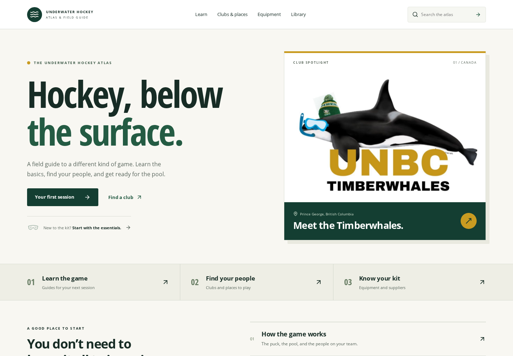

# Timberwhales visual and usability review

Prepared November 8, 2026 for the existing draft PR #4.

## Open the working preview

[Download preview.html](preview.html?raw=1), save it locally, and open it in a
browser. The application, catalog, original club logo, fonts, and favicon are
embedded. The local pages and interactions work without a network connection;
external source links open their original websites.

The preview contains the same application as the production build. It is a
review artifact, and is not the published GitHub Pages site.

## What changed

- Forest green, warm white, and restrained gold give the atlas a stronger visual
  identity informed by the supplied club artwork.
- The homepage has a clear first-session action and a prominent Timberwhales
  feature. An interactive formation diagram provides an entry for returning players.
- The approved primary sections remain Learn, Clubs & places, Equipment, and Library.
- Learn is a compact index in topic order with an explicit beginner entry.
- Directory and supplier results use aligned rows. The directory starts in List
  view on every device; an explicit Map URL retains the schematic map.
- Library explanations and evidence are available through disclosures. Phone
  filters are full-width so selected values remain readable.
- Mobile search is an expandable header control. Ctrl/Cmd+K focuses search,
  Escape closes it, and submitting a query moves focus to the results.
- Sticky-header offsets keep article contents, selected records, and search
  result jumps visible. Existing URLs and browser Back behavior are retained.
- The original logo file is unchanged. Its blank margins are handled by the
  display frame, without redrawing or recoloring the artwork.

## Screenshots

| Page | Desktop | Phone |
| --- | --- | --- |
| Home | [Full page](home-desktop.png), [first screen](review-cover.png) | [Full page](home-mobile.png) |
| Learn | [Desktop](learn-desktop.png) | [Phone](learn-mobile.png) |
| Clubs & places | [Desktop](clubs-desktop.png) | [Phone](clubs-mobile.png) |
| Timberwhales profile | [Desktop](club-desktop.png) | [Phone](club-mobile.png) |
| Equipment | [Desktop](equipment-desktop.png) | [Phone](equipment-mobile.png) |
| Suppliers | [Desktop](suppliers-desktop.png) | [Phone](suppliers-mobile.png) |
| Library | [Desktop](library-desktop.png) | [Phone](library-mobile.png) |



## Design review

An independent screenshot and source review scored the revised design **93/100**.
This is a subjective design assessment, not a measured visitor-success rate or
an accessibility certification.

| Category | Score |
| --- | ---: |
| Visual identity and hierarchy | 24/25 |
| Navigation and task clarity | 23/25 |
| Responsive layout and readability | 23/25 |
| Accessibility and interaction consistency | 23/25 |
| Total | 93/100 |

The first review scored 89/100. The revised version corrected cramped mobile
navigation rows, clipped select text, a heading spacing issue, an unmodified
single-character shortcut, repeated-search focus loss, and search jumps hidden
behind the header. A narrow-phone schedule overflow was also corrected.

## Verification

| Check | Result |
| --- | --- |
| TypeScript, ESLint, production build | Passed |
| Content and catalog suite | 18 passed |
| Chromium browser suite | 40 passed, 2 intentional shared-viewport skips, 0 failed |
| Direct-file preview | No external asset requests, page errors, or captured overflow |
| Supplied logo | Byte-for-byte match with the uploaded JPEG |

The content and catalog suite retains all 27 articles, 207 source records,
57 directory entries, and 12 suppliers. Raw research catalogs, generated source
data, original links, and evidence qualifications are unchanged.

Browser coverage includes desktop and phone routes, source evidence, exact
search destinations, filters, pagination, map selection, Back restoration,
keyboard search, the skip link, and navigation focus. Reflow is checked at
320, 360, and 768 CSS pixels, plus a 720 CSS-pixel viewport at 2x pixel density.
The density check does not operate native browser zoom.

The standalone preview was also opened directly from disk. Fifteen captures
across the main pages showed no horizontal overflow or page errors. Its fonts
and logo loaded locally, with no external asset requests.

Run the checks with:

```sh
npm ci
npm run typecheck
npm run lint
npm test
npm run build
npx playwright install chromium
npm run test:ui
node scripts/build_review_preview.mjs
```

`CHROMIUM_PATH` can select an installed Chromium executable. The final GitHub
verification status is available in [PR #4](https://github.com/amirrad98/underwater-hockey-atlas/pull/4/checks).

## Remaining limits

Some secondary source metadata and diagram labels remain small. The optional
map is a schematic coordinate grid, and the underlying source dates remain
visible. This redesign does not reverify club schedules or supplier information.
Visitor usability sessions and manual screen-reader testing have not been
performed. Vite retains its existing large-chunk advisory because the full
source catalog is bundled, at roughly 159 kB gzipped for JavaScript.

The draft is ready for the owner's design review before merge and publication.
